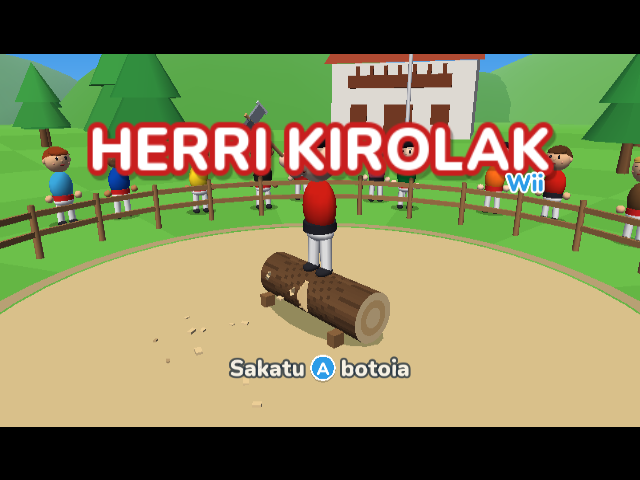
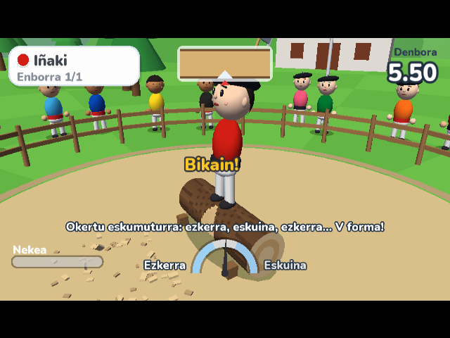
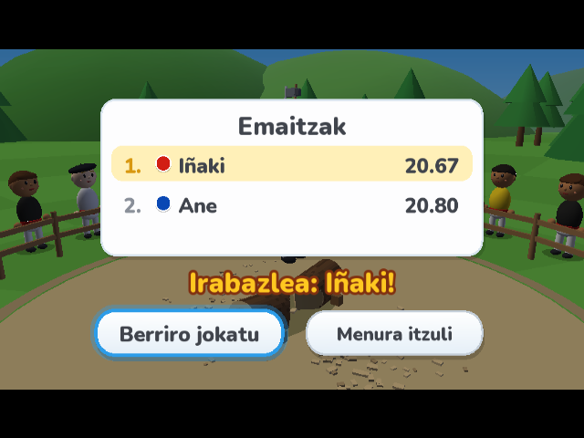

# Herri Kirolak Wii 🪓

Homebrew game for the Nintendo Wii inspired by Wii Sports, featuring Basque rural sports (*herri kirolak*). First event: **Aizkolaritza** (wood chopping).

Built with [devkitPro](https://devkitpro.org/) (devkitPPC + libogc). Runs on a real Wii through the Homebrew Channel, or in [Dolphin](https://dolphin-emu.org/).

> Personal side project, vibe-coded with Claude. UI text is in Basque (euskara).

| Title | Aizkolaritza | Results |
|---|---|---|
|  |  |  |

**Aizkolaritza**: stand on the log and chop a V-shaped notch, alternating left and right cuts by twisting your wrist. Halfway through, turn around (B) and chop the other side until the log splits. Training mode, or a 1–4 player turn-based competition (with CPU players), records saved to USB/SD.

Everything is generated by code: Mii-like characters and scenery are procedural geometry, sound effects are synthesized (`tools/gen_sfx.py`), and the font is Nunito (OFL).

## Build
1. Install devkitPro with the `wii-dev` group.
2. `make` (or `scripts/build.ps1` on Windows) → `build/boot.dol`

## Play on Wii
Copy `hbc/herri-kirolak/` + `boot.dol` to `apps/herri-kirolak/` on a FAT32 USB drive or SD card and launch it from the Homebrew Channel.

See [docs/SPEC.md](docs/SPEC.md) and [docs/ROADMAP.md](docs/ROADMAP.md).
